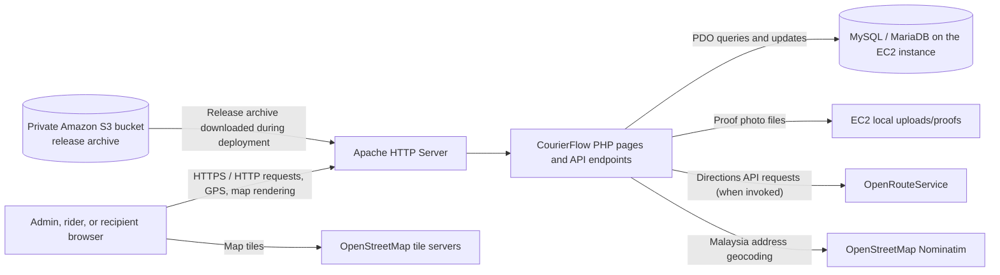
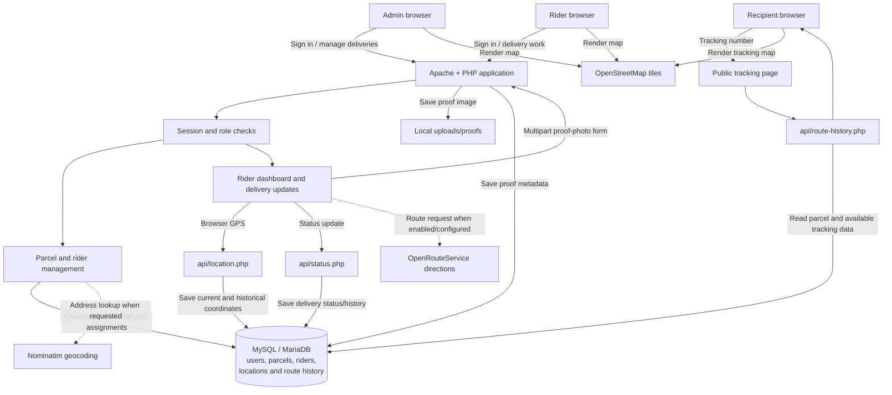
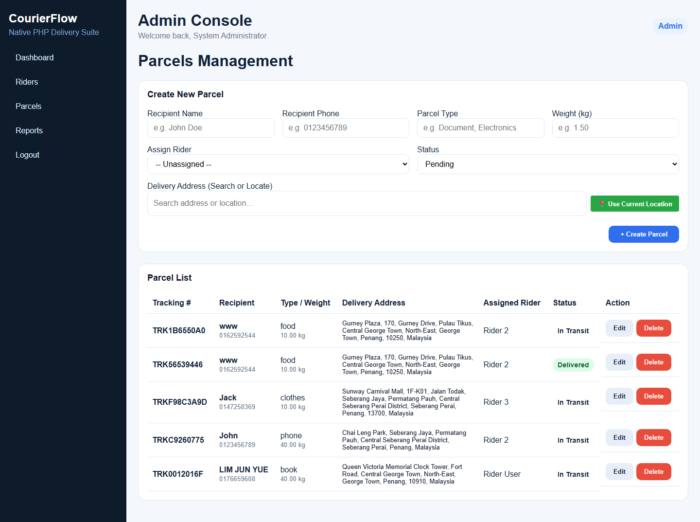
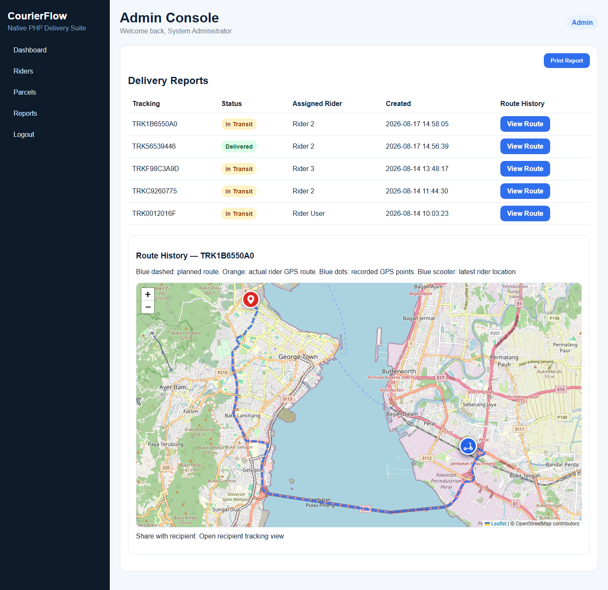
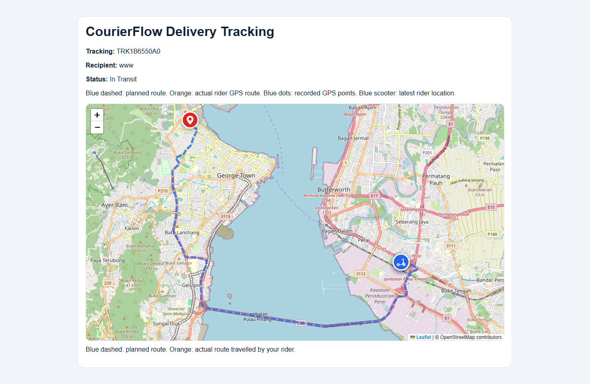

# CourierFlow — Parcel Delivery Management System

CourierFlow is a native PHP web application for managing parcel deliveries. Administrators manage riders and parcels, riders share their GPS location and update delivery status, and recipients can view a public parcel tracking page with route history when route data is available.


## Contents

- [Features](#features)
- [Technology stack](#technology-stack)
- [Architecture](#architecture)
- [Application flow](#application-flow)
- [Methodology](#methodology)
- [Repository layout](#repository-layout)
- [Local setup](#local-setup)
- [AWS deployment: Amazon Linux EC2 and S3](#aws-deployment-amazon-linux-ec2-and-s3)
- [Current implementation notes](#current-implementation-notes)
- [Screenshots](#screenshots)
- [License](#license)

## Features

- Admin dashboard, rider directory, parcel management, and delivery reports
- Rider accounts, online/offline state, assigned delivery list, and browser GPS updates
- Parcel status history and delivery proof photo uploads
- Public tracking page showing parcel status, rider position, and available planned/actual route history
- Malaysia address geocoding through OpenStreetMap Nominatim
- Leaflet maps using OpenStreetMap tiles
- OpenRouteService (`driving-car`) route calculation endpoint and saved route snapshots

## Technology stack

| Area | Technology |
| --- | --- |
| Server | Native PHP (no PHP framework; no Composer or Node build is required) |
| Database | MySQL or MariaDB, accessed through PHP PDO |
| Browser UI | HTML, CSS, JavaScript |
| Maps | Leaflet and OpenStreetMap |
| Address lookup | OpenStreetMap Nominatim |
| Road directions | OpenRouteService Directions API |
| File uploads | Local `uploads/proofs/` directory |
| AWS deployment target | Amazon Linux 2023 on EC2; private S3 bucket for the release archive |

## Architecture



The application is a traditional server-rendered PHP site. PHP handles pages, sessions, authorization, database operations, and JSON endpoints. JavaScript in the browser requests GPS permission and updates maps. On the AWS setup below, Apache, PHP, and the database run on one EC2 instance; S3 is used to transfer the release bundle, not to execute PHP.

## Application flow

The following diagram shows the main operational flow. Solid connections represent requests or data writes; external mapping services are optional dependencies used by relevant screens/endpoints.



In sequence:

1. An admin or rider signs in. PHP validates the session and role before rendering protected pages or accepting protected API requests. A recipient can visit `track.php` without signing in and provide a tracking number.
2. The admin creates and manages parcels and riders. Parcel/rider data is stored in MySQL/MariaDB.
3. When online, the rider dashboard requests browser location access and sends coordinates to `api/location.php`. PHP updates the rider's current position and records location history in the database.
4. Rider status changes are sent to `api/status.php`; delivery proof images, when uploaded, are saved under `uploads/proofs/` and status/history data is stored in the database.
5. The tracking page requests `api/route-history.php`, which reads parcel status and available location/route data. The page renders available details and locations on a Leaflet map.
6. When a relevant lookup or route endpoint is used and configured, PHP calls Nominatim for Malaysia address geocoding or OpenRouteService for road directions. Map tiles are fetched by the browser from OpenStreetMap.

## Methodology

CourierFlow follows a lightweight, role-based, request/response methodology:

1. **Role-oriented interaction:** Admin, rider, and public recipient screens present different actions. Session checks and role checks protect authenticated pages and API operations.
2. **Server-rendered application:** PHP serves pages and handles business operations. Browser JavaScript provides interactive maps, GPS capture, and asynchronous requests to PHP JSON endpoints.
3. **Relational persistence:** MySQL/MariaDB is the system of record for users, riders, parcels, delivery status, and location/route history. PDO prepared statements are used for database operations.
4. **Event-by-request updates:** Rider GPS and status changes are submitted as browser requests. The server persists the latest state and relevant history, which admin and tracking views read back.
5. **External service integration:** Geocoding and driving directions are requested from external services by PHP when the corresponding code path is active and credentials/connectivity are available. Leaflet displays maps in the browser using OpenStreetMap tiles.
6. **File handling:** Proof images are uploaded to the application host's `uploads/proofs/` directory; their metadata is associated with delivery records in the database. The current implementation does not store these files in S3.
7. **Incremental deployment:** The application can run on a local Apache/PHP/MySQL environment or a single Amazon Linux EC2 host. S3 in the documented AWS setup stores and transfers a private application release archive; it is not the PHP runtime.

This describes the current implementation rather than a claim of continuous real-time streaming or a fully managed cloud architecture. See [Current implementation notes](#current-implementation-notes) for known feature/schema limitations.

## Repository layout

| Path | Purpose |
| --- | --- |
| `admin/` | Admin parcel, rider, and reports pages |
| `api/` | JSON endpoints for locations, routes, status, riders, and route history |
| `assets/css/`, `assets/js/`, `assets/images/` | Front-end styles, scripts, and images |
| `includes/` | Shared page fragments |
| `database.sql` | MySQL/MariaDB schema and initial admin/rider records |
| `database.example.php` | Local/server database configuration template |
| `track.php` | Public parcel tracking page |
| `uploads/proofs/` | Runtime destination for delivery proof images (not included as app code) |

## Local setup

### Requirements

- XAMPP on Windows, or another Apache + PHP + MySQL/MariaDB environment
- PHP PDO MySQL and cURL extensions enabled
- A browser; browser GPS is available on `localhost` or a secure HTTPS origin
- Optional OpenRouteService API key for route calculations

### Install

1. Clone or copy the repository into the web root, for example:

   ```text
   C:\xampp\htdocs\parcel_delivery_system
   ```

2. Copy `database.example.php` to `database.php` in the project root:

   ```powershell
   Copy-Item database.example.php database.php
   ```

3. Edit `database.php` with your local MySQL credentials. The XAMPP defaults are shown:

   ```php
   $db_host = '127.0.0.1';
   $db_user = 'root';
   $db_pass = '';
   $db_name = 'parcel_delivery_system';
   $ors_api_key = ''; // Optional: OpenRouteService key
   ```

   `database.php` is ignored by Git. Never commit real passwords or API keys.

4. Start **Apache** and **MySQL** in the XAMPP Control Panel.
5. Import `database.sql` into MySQL using phpMyAdmin (`http://localhost/phpmyadmin`) or the MySQL command line. The script creates the `parcel_delivery_system` database and its initial admin/rider records. Do not rely on `install.php`: it is not part of the tracked release.
6. Ensure the proof-upload directory exists and is writable by Apache:

   ```powershell
   New-Item -ItemType Directory -Force uploads\proofs
   ```

7. Open `http://localhost/parcel_delivery_system/`.

The initial accounts created by the checked-in SQL are:

| Role | Email | Password |
| --- | --- | --- |
| Admin | `admin@example.com` | `password` |
| Rider | `rider@example.com` | `password` |

These are demo credentials only. Change them before exposing the app to a network.

### Optional routing key

Set the OpenRouteService key in the `$ors_api_key` value in `database.php`. The server uses this key for route requests. Do not place a real key in tracked source files. A secure environment-based configuration would require a small configuration change: the current `database.example.php` defines `$ors_api_key` as an empty string, which takes precedence over the environment fallback in `config.php`.

## AWS deployment: Amazon Linux EC2 and S3

This is a low-cost single-instance demonstration deployment, not a highly available production architecture. PHP must run on EC2; an S3 static website endpoint cannot execute this application. The S3 bucket below is private and is used to hold/download the release archive. Proof photos continue to be stored on the EC2 instance.

### Before you start

- An AWS account with billing enabled. Free Tier eligibility, instance sizes, included hours/storage, and account offers vary by account creation date and region. Confirm the current offer and pricing in the AWS Console before launch.
- A region close to the intended users.
- A release ZIP containing the tracked application files. Exclude local `database.php`, credentials/API keys, `.git`, local database dumps, and any private uploads. Arrange the ZIP so the application files (including `database.sql` and `database.example.php`) are at its top level.
- An OpenRouteService key if road routing is required.

Set a billing budget/alert in **Billing and Cost Management** before launching. Budget alerts notify you; they do not automatically stop resources. Avoid creating a NAT Gateway or other chargeable services for this single-instance setup. Public IPv4 addresses, data transfer, storage, and services outside your account's offer may incur charges.

### 1. Create a private S3 release bucket

1. In the AWS Console, open **S3 → Create bucket**.
2. Choose a globally unique bucket name and the same AWS Region you will use for EC2.
3. Keep **Block all public access** enabled and leave the bucket private. Do not enable static website hosting.
4. Create the bucket, then choose **Upload** and upload the release ZIP, for example `courierflow-release.zip`.
5. Keep the bucket name and ZIP object key for the EC2 download step.

### 2. Create a least-privilege EC2 role for S3 download

1. Open **IAM → Roles → Create role**. Select **AWS service → EC2** as the trusted entity.
2. Add a permissions policy that allows `s3:GetObject` on only the release object (and `s3:ListBucket` on only the release bucket if needed). Do not make the bucket public or put long-lived AWS access keys on the instance.
3. Name the role (for example, `CourierFlowEc2ReleaseRead`) and create it.
4. If you use an inline/custom policy, scope its resources to your bucket ARN and the release object's ARN; do not grant broad S3 access unnecessarily.

### 3. Launch Amazon Linux EC2

1. Open **EC2 → Instances → Launch instances**.
2. Set a name such as `courierflow-web`.
3. For **Application and OS Images (Amazon Machine Image)**, select **Amazon Linux 2023 AMI**. Choose an instance type explicitly marked eligible for your account's current Free Tier offer; availability and names vary by region/account.
4. Create or select a key pair, unless you will connect using an available EC2 Instance Connect option.
5. Create a security group with inbound rules:
   - SSH (TCP 22): **My IP** only, if using SSH.
   - HTTP (TCP 80): `0.0.0.0/0` (and `::/0` if using IPv6).
   - HTTPS (TCP 443): `0.0.0.0/0` (and `::/0` if using IPv6), for the later TLS setup.
   - Do **not** expose MySQL/MariaDB port 3306 to the internet.
6. Expand **Advanced details → IAM instance profile** and select the EC2 role created in step 2.
7. Launch the instance. Wait for status checks to pass and note its public IPv4 address or DNS name.

### 4. Connect and install the web/database services

Use **EC2 → Instances → Connect** (EC2 Instance Connect, if available) or SSH with your downloaded key. On the Amazon Linux shell, run:

```bash
sudo dnf update -y
sudo dnf install -y httpd php php-mysqlnd php-curl mariadb105-server unzip
sudo systemctl enable --now httpd mariadb
php -v
aws --version
```

Amazon Linux images may differ in which optional utilities are preinstalled. If the `aws` command is unavailable, install AWS CLI v2 using AWS's current Amazon Linux instructions before continuing; do not configure permanent access keys on the instance.

### 5. Download and unpack the application from S3

Replace the bucket and object-key placeholders with the values from step 1:

```bash
aws s3 cp s3://YOUR-PRIVATE-BUCKET/courierflow-release.zip /tmp/courierflow-release.zip
sudo unzip -o /tmp/courierflow-release.zip -d /var/www/html
```

The ZIP should have application files at its root, not an extra enclosing directory. Confirm that `/var/www/html/index.php`, `/var/www/html/database.sql`, and `/var/www/html/database.example.php` exist.

### 6. Create the application database and account

Import the checked-in schema and demo admin/rider records:

```bash
sudo mysql < /var/www/html/database.sql
```

Then open the local database shell:

```bash
sudo mysql
```

At the MariaDB prompt, create a database user with a unique strong password (replace the example value) and grant it access only to the application database:

```sql
CREATE USER 'courierflow_app'@'localhost' IDENTIFIED BY 'REPLACE_WITH_A_LONG_RANDOM_PASSWORD';
GRANT ALL PRIVILEGES ON parcel_delivery_system.* TO 'courierflow_app'@'localhost';
FLUSH PRIVILEGES;
EXIT;
```

### 7. Configure PHP and file permissions

Copy the template, then edit the server-only config:

```bash
cd /var/www/html
sudo cp database.example.php database.php
sudo nano database.php
```

Set the values in `database.php` to the database name/user/password created above, use `localhost` for the database host, and optionally set `$ors_api_key` to your OpenRouteService key. Keep this file private and never put it in the S3 release ZIP or source control.

Create the proof upload directory and give Apache write access only to that directory:

```bash
sudo mkdir -p /var/www/html/uploads/proofs
sudo chown -R root:apache /var/www/html
sudo find /var/www/html -type d -exec chmod 755 {} \;
sudo find /var/www/html -type f -exec chmod 644 {} \;
sudo chown -R apache:apache /var/www/html/uploads
sudo chmod -R 750 /var/www/html/uploads
sudo chown root:apache /var/www/html/database.php
sudo chmod 640 /var/www/html/database.php
```

If SELinux is enforcing, allow Apache to connect to the local database:

```bash
sudo setsebool -P httpd_can_network_connect_db 1
```

### 8. Test the site

1. In a browser, open `http://EC2-PUBLIC-IP/`. Confirm that the home/login page loads.
2. Log in using the demo admin account (`admin@example.com` / `password`) and verify the dashboard and database connection.
3. Change the demo passwords immediately. Do not use the demo accounts for real deliveries.
4. Check **EC2 → Security Groups** if the page cannot be reached. Do not solve connectivity issues by opening port 3306.
5. Review the Apache error log if the page fails:

   ```bash
   sudo tail -n 100 /var/log/httpd/error_log
   ```

### 9. Configure HTTPS before using rider GPS

Browser geolocation requires a secure context: HTTPS, or localhost for local development. An EC2 public IP over HTTP is not enough for rider GPS. Point a domain name to the instance, obtain/configure a TLS certificate (for example, with a certificate authority such as Let's Encrypt), enable HTTPS in Apache, and allow inbound TCP 443. Do not collect real rider locations until HTTPS is working.

### S3 scope and backups

S3 is used here as a private release artifact store. The current PHP upload code writes proof photos to the EC2 `uploads/proofs/` directory; it does not upload those photos to S3. Moving proofs to S3 requires an application change and IAM permissions. Consider a separate, restricted backup process for database dumps and uploads; do not place database credentials or unencrypted sensitive data in a public bucket.

## Current implementation notes

- The tracked `database.sql` schema defines only the `admin` and `rider` roles and does not define the `customer_id`, `notifications`, or OTP tables referenced by some customer-related pages and code. Customer registration/dashboard, customer notifications, and OTP-related flows therefore need matching schema migrations before they can be relied on.
- `api/route.php` contains OpenRouteService route calculation logic, but the current rider dashboard JavaScript displays a “road route calculation is disabled” message. Public tracking can show saved route data when available; verify the desired route workflow in the running version before depending on live directions.
- The database schema seeds demo credentials. Change them before deployment and treat all location, recipient, and proof-photo data as sensitive.
- The single EC2 instance is a learning/demo deployment. It has no automatic scaling, managed database, multi-AZ failover, or built-in S3 photo storage.

## Screenshots

| Login | Admin dashboard |
| --- | --- |
|  |  |

| Parcel management | Rider directory |
| --- | --- |
|  |  |

| Delivery reports & route history | Rider dashboard |
| --- | --- |
|  |  |



More images are in [`docs/screenshots/`](docs/screenshots/).

## License

This project is released under the [MIT License](LICENSE).
