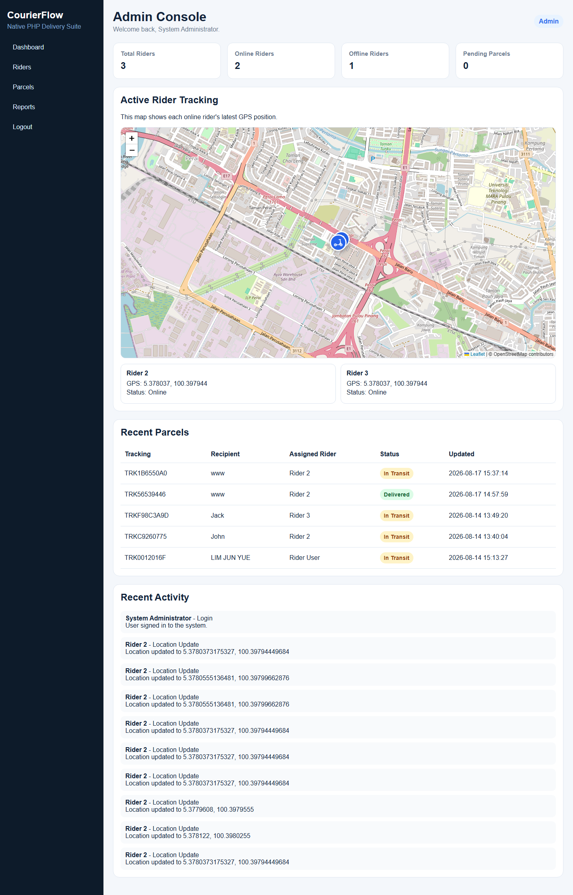
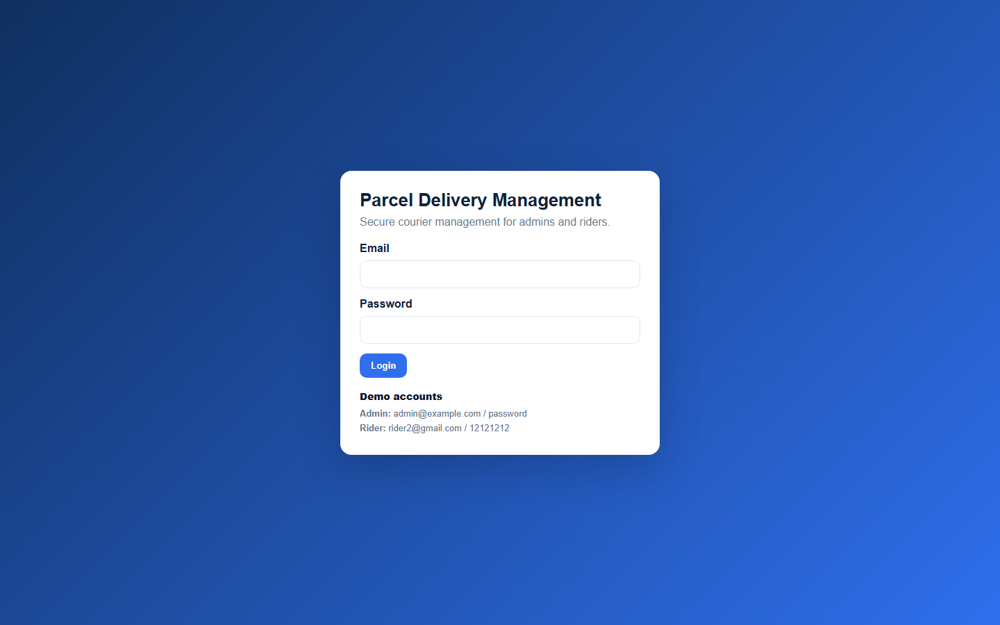
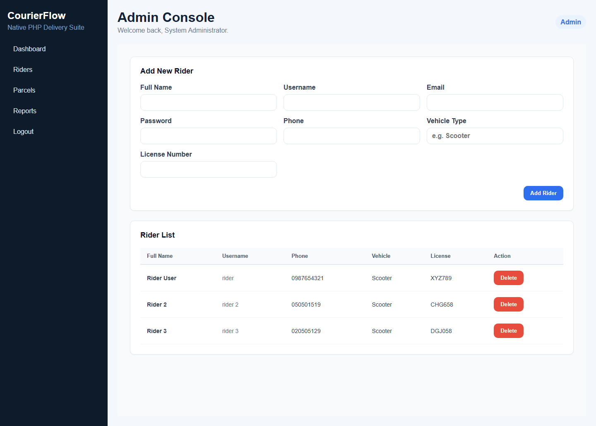
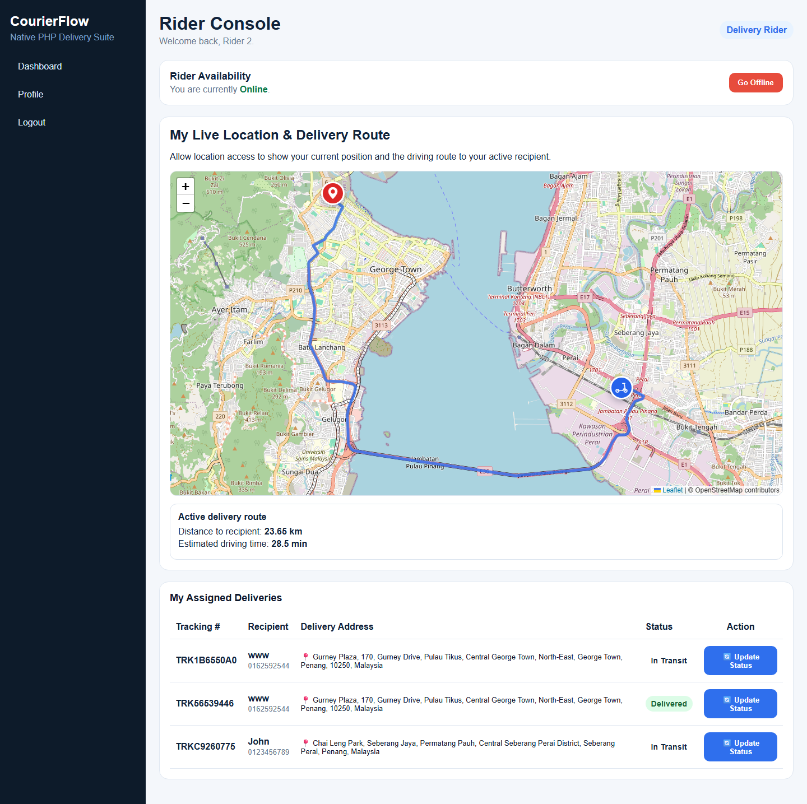

# Parcel Delivery Management System

CourierFlow is a native PHP parcel delivery system with Malaysia live road routing. Admins manage riders and parcels; riders update GPS and delivery status; recipients can open a public tracking page.



## Screenshots

| Login | Admin dashboard |
| --- | --- |
|  |  |

| Parcel management | Rider directory |
| --- | --- |
|  |  |

| Delivery reports & route history | Rider live route |
| --- | --- |
|  |  |


More images are in [`docs/screenshots/`](docs/screenshots/).

## Features

- Admin dashboard with rider GPS tracking on a Leaflet / OpenStreetMap map
- Create, assign, edit, and delete parcels
- Rider accounts, online/offline status, and assigned delivery list
- Malaysia address search and geocoding
- OpenRouteService `driving-car` route from the rider's latest GPS point to the recipient
- Auto-refresh route while the rider is moving
- Delivery reports with planned vs actual GPS route history
- Public tracking page for recipients
- Proof-of-delivery photo upload when a rider updates status

## Tech stack

- PHP (native, no framework)
- MySQL / MariaDB
- Leaflet + OpenStreetMap
- OpenRouteService Directions API

## Setup

1. Clone this repository into `C:\xampp\htdocs\` (or your web root).
2. Copy the database template and enter your local MySQL credentials:

   ```bash
   copy database.example.php database.php
   ```

   Edit `database.php`:

   ```php
   $db_host = '127.0.0.1';
   $db_user = 'root';
   $db_pass = '';
   $db_name = 'parcel_delivery_system';
   $ors_api_key = getenv('ORS_API_KEY') ?: 'YOUR_ORS_API_KEY';
   ```

3. Start Apache and MySQL in XAMPP.
4. Open `http://localhost/parcel_delivery_management_system/install.php` once to create tables and demo users.
5. Log in at `http://localhost/parcel_delivery_management_system/login.php`.

`database.php` is git-ignored so your password is not published.

### Demo accounts

| Role | Email | Password |
| --- | --- | --- |
| Admin | `admin@example.com` | `password` |
| Rider | `rider@example.com` | `password` |

If you already imported an older demo database, a second rider may also exist: `rider2@gmail.com` / `12121212`.

### Malaysia live routing

1. Open the Rider Dashboard and allow browser location permission.
2. As Admin, open **Riders** or the dashboard map, then assign a parcel with a full Malaysian address.
3. The server geocodes the address, saves coordinates, and draws the driving route.

Use complete addresses such as:

```
123, Jalan ABC, Taman XYZ, 08000 Sungai Petani, Kedah, Malaysia
```

Browser GPS normally requires HTTPS or `localhost`.

### API key

Set `ORS_API_KEY` as a server environment variable, or put the key in your local `database.php`. Do not commit the real key. Rotate it if it was previously pushed to a public repository.

## License

This project is released under the [MIT License](LICENSE).
